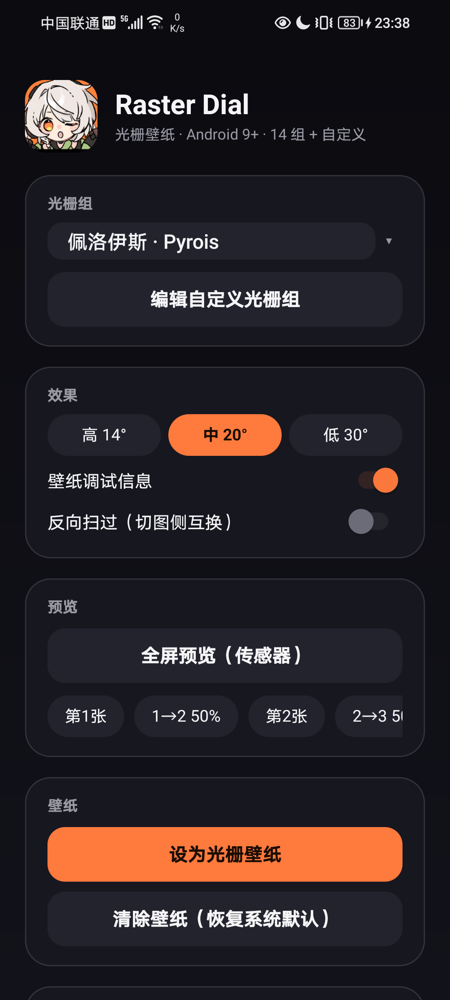
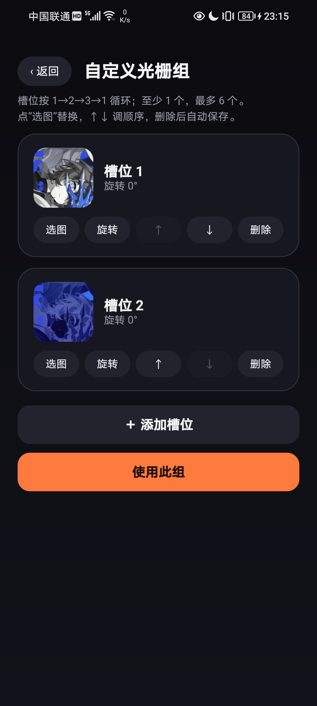

**English** | [简体中文](README.md)


# Raster Dial

A lenticular live wallpaper for Android 9+: tilt the phone and the image transitions between 2–3 layers along a single soft gradient boundary. 14 built-in groups, custom slots, tablet/landscape support, and debouncing.

<p align="center">
  
  
  
</p>

## Features

- **Single soft gradient boundary**: one ~18% screen-width gradient band between A and B, not a stripe or a hard cut.
- **2D direction**: left/right, up/down, and diagonal tilts all work; the boundary follows the tilt direction.
- **Cycling**: `phase` is unbounded; 2–3 images cycle as `1→2→3→1`.
- **Debouncing**: One Euro Filter + soft dead zone + direction dead zone + a 3 cycles/s phase limit; the half-range angle is multiplied by 1.2 on tablets/landscape.
- **14 built-in groups + custom**: Alice, Astra Yao, Evelyn, Hugo, Miyabi, Nicole, Norma, Promeia, Pyrois, Remielle, Starlight-Billy, Vivian, Ye Shunguang, Yixuan.
- **Custom groups**: 1–6 slots with pick, rotate 90°, reorder, and delete.
- **Tablets/foldables**: the runtime surface aspect ratio selects portrait/landscape assets; aspect-fill cropping; display-rotation compensation.
- **Wallpaper only**: no lock-screen takeover, no flashing, no boot service.

### Effect Details

- 2–3 images per group: Pyrois has 2; the other 13 have 3; 14 groups / 41 images in total.
- Images are ranked by colorfulness (1 = most colorful; 2/3 decrease). Scores are in `app/src/main/assets/groups/groups.json` under `scores`.
- Portrait assets are the source images rotated 90° clockwise; landscape assets use the original orientation.
- Half-range angle (tilt needed for one transition): high 14° / medium 20° (default) / low 30°. A full A→B→A cycle is 2 × the half-range.
- Pose uses the axis-angle `(x, y)` of the relative quaternion, not Euler angles; face-down or near-horizontal poses do not strobe from roll/pitch flips.
- Debounce: soft dead zone 0.015 rad (~0.86°), direction dead zone 0.02 rad (~1.15°), phase limit 3 cycles/s.
- 3-image groups: 0→1 first→second, 1→2 second→third, 2→3 third→first; 2-image groups: 0→1 first→second, 1→2 second→first.

## Table of Contents

- [Features](#features)
- [Quick Start](#quick-start)
- [Project Structure](#project-structure)
- [Configuration and Usage](#configuration-and-usage)
- [Common Commands](#common-commands)
- [Testing](#testing)
- [Custom Groups](#custom-groups)
- [Assets and License](#assets-and-license)
- [Known Limitations and Roadmap](#known-limitations-and-roadmap)
- [License](#license)

## Quick Start

### Prerequisites

- JDK 17 or newer (`sourceCompatibility = VERSION_17` in `app/build.gradle.kts`; AGP 9.2.1)
- Android SDK Platform 36 (`compileSdk = 36`), with `ANDROID_HOME` pointing at the SDK root
- An Android 9+ (API 28) device with USB debugging enabled
- _(Optional)_ Python 3.10+, Pillow, and NumPy — only for regenerating the built-in assets

### Build and Install

```bash
git clone https://github.com/kdjdhe/raster-dial.git
cd raster-dial

# Command-line builds need local.properties; Android Studio creates it automatically.
echo "sdk.dir=$ANDROID_HOME" > local.properties
./gradlew assembleDebug

adb install -r app/build/outputs/apk/debug/app-debug.apk
```

Open Raster Dial → choose a group → **Set as live wallpaper** → confirm in the system live-wallpaper preview.

Or download the [latest release APK](https://github.com/kdjdhe/raster-dial/releases/latest) (debug-signed; sideload only).

## Project Structure

| Path | Purpose |
|---|---|
| `app/src/main/java/com/raster/dial/` | Java sources: wallpaper service, GL preview, sensors/debouncing, group catalog, custom slots |
| `app/src/main/AndroidManifest.xml` | App, preview, wallpaper service, and debug receiver declarations |
| `app/src/main/assets/groups/` | Portrait assets 1080×2400 (14 groups; source images rotated 90°) |
| `app/src/main/assets/groups_land/` | Landscape assets 1920×1080 (source images unrotated) |
| `app/src/main/assets/groups/groups.json` | Group catalog, names, colorfulness scores |
| `app/src/main/res/` | Icons, strings, wallpaper metadata |
| `tools/build_groups.py` | Builds portrait assets and `groups.json` |
| `tools/build_landscape.py` | Builds landscape assets |
| `docs/COMPATIBILITY.md` | Compatibility analysis for other Android devices and tablets |
| `docs/screenshots/` | README screenshots |

## Configuration and Usage

| Control | Purpose |
|---|---|
| Group | 14 built-in groups + custom; shown as "Chinese name · English" |
| Sensitivity | High 14° / medium 20° / low 30° (half-range angle) |
| Wallpaper debug line | Bottom-left: group, portrait/landscape, rotation, `phase`, segment, segment progress, direction, frame time |
| Invert sweep | Swap the side the gradient sweeps from |
| Edit custom group | 1–6 slots; pick / rotate / reorder / delete |
| Set as live wallpaper | Opens the system live-wallpaper picker |
| Clear wallpaper | Restores the system default static wallpaper |

Debug broadcast (the `-n` component is required; implicit broadcasts are not delivered on this EMUI build):

```bash
# Switch group
adb shell am broadcast -n com.raster.dial/.WallDebugReceiver \
  -a com.raster.dial.WALL_DEBUG --es group Miyabi

# Pin phase/direction (45° diagonal at 50%)
adb shell am broadcast -n com.raster.dial/.WallDebugReceiver \
  -a com.raster.dial.WALL_DEBUG --ef progress 0.5 --ef dirX 0.707 --ef dirY 0.707

# Clear pinned values and return to the sensors
adb shell am broadcast -n com.raster.dial/.WallDebugReceiver \
  -a com.raster.dial.WALL_DEBUG --ez clear true
```

> The debug broadcast writes `wall_progress` into SharedPreferences; the wallpaper stays at the pinned value until it is cleared. The in-app "Clear debug override" action is equivalent.

### Tablet and Landscape

The code does not hard-code resolutions. It checks the surface aspect ratio and the current display rotation at runtime:

1. `onSurfaceChanged(width, height)` sets `landscape = width > height`;
2. portrait loads `app/src/main/assets/groups/`; landscape loads `app/src/main/assets/groups_land/`;
3. drawing uses aspect-fill center cropping, never stretching;
4. sensor direction is rotated by `Display.getRotation()` into the current screen coordinates;
5. the half-range angle is multiplied by 1.2 on tablets/landscape.

The same code covers 20:9 phones, 19.5:9, 21:9, 16:10 tablets, and folded/unfolded foldables without a per-resolution asset set. See [docs/COMPATIBILITY.md](docs/COMPATIBILITY.md).


## Common Commands

```bash
./gradlew assembleDebug          # build the debug APK
./gradlew test                   # unit-test task (no test sources currently)
./gradlew lint                   # Android Lint
python tools/build_groups.py     # rebuild portrait assets + groups.json
python tools/build_landscape.py  # rebuild landscape assets
```

Asset generation reads the repository's `art` directory by default; you can also point `RASTER_SRC` at your source-art directory:

```bash
RASTER_SRC=/path/to/art python tools/build_groups.py
RASTER_SRC=/path/to/art python tools/build_landscape.py
```

The `sources` field in `groups.json` records the original file for each slot (1/2/3).

## Testing

No test files are present in the repository; `./gradlew test` runs but skips. Build checks:

```bash
./gradlew assembleDebug
./gradlew test
gradle test             # equivalent when Gradle 9.7.1 is installed
./gradlew lint
```

Manual acceptance on a device:

1. Install and set the wallpaper.
2. Tilt left/right, up/down, and diagonally; confirm there is only one gradient boundary.
3. Keep tilting; confirm the `1→2→3→1` cycle.
4. Hold still for 30 seconds; confirm there is no visible jitter.
5. Rotate to landscape or force a tablet size; confirm landscape assets and direction.
6. In a custom group, pick, rotate, reorder, and delete.
7. Switch groups; confirm the wallpaper updates within about 0.5 seconds.

## Custom Groups

- Two slots are seeded from Pyrois on first run;
- Each slot supports pick (system file picker), rotate 90°, move up/down, and delete;
- 1–6 slots; slots cycle `1→2→3→1`;
- "Use this group" switches the wallpaper to the custom group;
- Files live in the app's private `files` directory under `custom`: `group.json` plus each slot's `m_*.webp` (master) and `s_*.webp` (rotated display);
- Imports are EXIF-corrected; the master's longest edge is 3000 px and the display's longest edge is 1600 px.

## Assets and License

- **Code**: MIT; see [LICENSE](LICENSE).
- **Bundled images**: `app/src/main/assets/groups/` and `app/src/main/assets/groups_land/` come from miHoYo's official Zenless Zone Zero "绳网情报站" wiki (https://baike.mihoyo.com/zzz/wiki/channel/map/2/43); copyright miHoYo / HoYoverse. They are **not covered by the MIT License**; the public repository is a personal demonstration only and grants no redistribution or commercial rights. The app icon, thumbnail, and README screenshots also contain official artwork. If you redistribute or use the project commercially, remove/replace these images or obtain permission; see [NOTICE](NOTICE).
- Regenerate assets: put the originals in the `art` directory or set `RASTER_SRC`, then run `tools/build_groups.py` and `tools/build_landscape.py`.

## Known Limitations and Roadmap

- **Home-screen live wallpaper only**; EMUI / MIUI / One UI / ColorOS lock screens are a separate system and are not guaranteed.
- The wallpaper uses a Canvas `saveLayer` + `LinearGradient` renderer; tablets/4K panels could use EGL + GLES2 to reduce GPU work.
- While visible, it redraws every 16 ms; event-driven + dirty rendering is planned to approach zero redraws when idle.
- Memory headroom: downscale for the target screen, RGB_565, and a 1600 px display edge for custom images.
- A real tablet/foldable smoke test is on the roadmap.
- The official artwork carries the IP risk described above.

See [CHANGELOG.md](CHANGELOG.md) for version history.

## Documentation Maintenance

Update this README when:

- a built-in group is added/removed, or `groups.json` fields change;
- the package name, `minSdk`/`targetSdk`, or version changes;
- the debug broadcast action or component changes;
- the asset scripts or the `RASTER_SRC` convention change;
- permissions, the wallpaper service, or an app entry point is added/removed.

## License

MIT License; see [LICENSE](LICENSE). The bundled official artwork is not covered by MIT; see [NOTICE](NOTICE).
