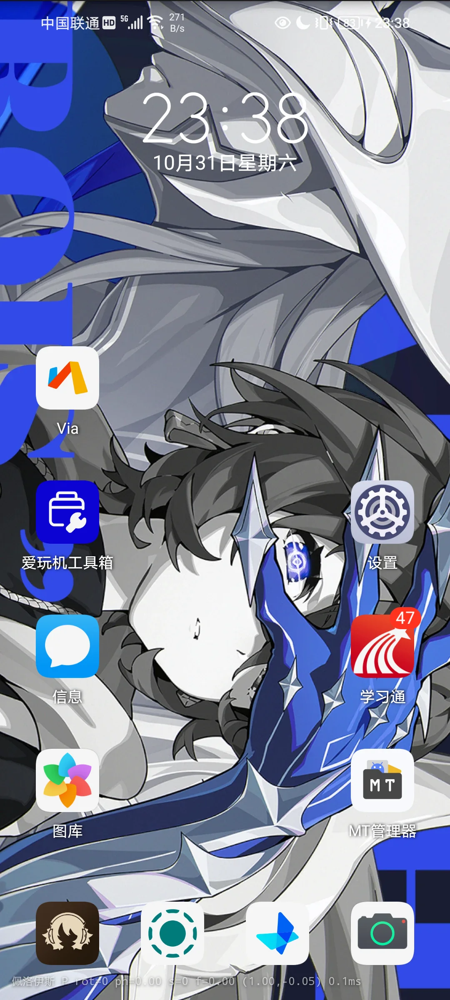

# Raster Dial

**简体中文** | [English](README.en.md)

Android 9+ 的光栅动态壁纸：倾斜手机，画面在 2–3 张图之间沿一条软渐变边界切换；内置 5 组示例角色、多个可命名自定义组、平板横竖屏与消抖。

<p align="center">
  
</p>

## 功能亮点

- **过渡线式（默认）**：A/B 两侧之间是一条约 18% 屏宽的软渐变带，不是条带，也不是硬切。
- **2D 方向**：左右、上下、斜向倾斜都连续；边界方向跟随倾斜方向。
- **循环切换**：`phase` 不截断，2–3 张图按 `1→2→3→1` 循环。
- **消抖**：One Euro Filter + 软死区 + 方向死区 + 3 圈/秒限速，压住手抖；平板/横屏半程角度 ×1.2。
- **三种过渡方式**：过渡线 / 百叶窗（六条带同步边界，随轴旋转成横/竖条）/ 类OriginOS（宽软渐变横扫；瞬时倾角映射场景 + 100ms 一锤子提交，不卡中间态）。
- **变化轴可配**：过渡线 全向 / 仅横向 / 仅竖向；百叶窗与类OriginOS 横向 / 竖向。
- **护眼强度**：0–30% 常驻亮度衰减（左端即关闭），减弱切换闪烁；每档轻震。
- **5 组内置示例 + 中文名**：仪玄、佩洛伊斯、星见雅、薇薇安、叶瞬光。
- **多个自定义组**：可新建、命名/重命名、删除；每组 1–6 张，选图、旋转 90°、长按拖拽排序、组内全屏预览。
- **平板/折叠屏**：运行时按 surface 宽高比选竖/横素材，aspect-fill 裁切，按屏幕旋转补偿方向。
- **只做壁纸**：不接管锁屏、不刷机、无开机自启服务。
- **应用内更新**：成都主源 → Gitee 副源 → GitHub 备用源，SHA-256 校验后交给系统安装器。
- **6 套主题**：曜石 / 冰川 / 森绿 / 霞紫 / 绯红 / 鎏金，主屏一键切换并记忆。
- **适配系统字号**：0.85×–2.0× 系统字体都不裁字；卡片、分段控件、对话框随文字增高，装饰图标固定 dp。
- **长按拖拽排序**：选择器里长按拿起、1:1 跟手、其他卡片弹簧让位、跨位轻震。
- **搜索 / 导入导出**：选择器内搜索光栅组；自定义组可打包分享、导入他人的组。

### 效果细节

- 每组 2–3 张图：Pyrois 2 张，其余 4 组各 3 张，共 5 组 / 14 张。
- 组内按色彩丰富度排序：1 = 最丰富，2/3 递减（Hasler-Süsstrunk 指标，分数见 `app/src/main/assets/groups/groups.json` 的 `scores`）。
- 原图顺时针旋转 90° 做竖屏素材；横屏素材用原图不旋转。
- 半程角度（一次切图所需倾角）：灵敏度滑杆 0–100% 对应 34° → 8.6°，默认 55% ≈ 20°；完整 A→B→A 循环 = 2 × 半程。
- 姿态用相对四元数的轴角 `(x,y)` 投影，不用 Euler 角；屏幕朝下或接近水平时不会因 roll/pitch 翻转而频闪。
- 消抖参数：软死区 0.015 rad（约 0.86°）、方向死区 0.02 rad（约 1.15°）、`phase` 限速 3 圈/秒。
- 三张组：0→1 第1→第2，1→2 第2→第3，2→3 第3→第1；两张组：0→1 第1→第2，1→2 第2→第1。

## 目录

- [功能亮点](#功能亮点)
- [快速开始](#快速开始)
- [项目结构](#项目结构)
- [配置与使用](#配置与使用)
- [常用命令](#常用命令)
- [测试与验证](#测试与验证)
- [自定义光栅组](#自定义光栅组)
- [素材与许可](#素材与许可)
- [锁屏壁纸实测](#锁屏壁纸实测)
- [已知限制与路线图](#已知限制与路线图)
- [许可证](#许可证)

## 快速开始

### 前置条件

- JDK 17 或更高（`app/build.gradle.kts` 的 `sourceCompatibility = VERSION_17`；AGP 9.2.1）
- Android SDK Platform 36（`compileSdk = 36`），并让 `ANDROID_HOME` 指向 SDK 根目录
- Android 9+（API 28）设备，开启 USB 调试
- _(可选)_ Python 3.10+、Pillow、NumPy —— 只有重新生成内置素材时需要

### 构建与安装

```bash
git clone https://github.com/kdjdhe/raster-dial.git
cd raster-dial

# 命令行构建需要 local.properties；用 Android Studio 打开时会自动生成
echo "sdk.dir=$ANDROID_HOME" > local.properties
./gradlew assembleDebug

adb install -r app/build/outputs/apk/debug/app-debug.apk
```

打开「Raster Dial」→ 选择光栅组 → **设为光栅壁纸** → 系统动态壁纸预览 → 应用。

也可以直接下载 [最新 Release APK](https://github.com/kdjdhe/raster-dial/releases/latest)（debug 签名，侧载使用）。

## 项目结构

| 路径 | 用途 |
|---|---|
| `app/src/main/java/com/raster/dial/` | Java 源码：壁纸服务、GL 预览、传感器与消抖、组选择器、自定义组 |
| `app/src/main/AndroidManifest.xml` | App、预览页、壁纸服务、调试广播的声明 |
| `app/src/main/assets/groups/` | 竖屏素材 1080×2400（5 组，原图旋转 90°） |
| `app/src/main/assets/groups_land/` | 横屏素材 1920×1080（原图不旋转） |
| `app/src/main/assets/groups/groups.json` | 组清单、中文名、色彩丰富度分数 |
| `app/src/main/res/` | 图标、字符串、壁纸元数据 |
| `tools/build_groups.py` | 竖屏素材 + `groups.json` 生成 |
| `tools/build_landscape.py` | 横屏素材生成 |
| `tools/publish_update.py` | 从 APK 生成 `update.json` |
| `tools/sync_chengdu.sh` | 上传 `update.json` + APK 到成都服务器 |
| `tools/sync_gitee.sh` | 推送 `main` 并把 APK 传到 Gitee Release（国内镜像） |
| `update.json` | App 更新清单（versionCode、SHA-256、成都/Gitee/GitHub 镜像） |
| `docs/UPDATE_SOURCE.md` | 成都服务器 + Gitee/GitHub 更新源部署与发布流程 |
| `docs/SIGNING.md` | debug/release 签名、keystore、更新源迁移 |
| `keystore.properties.example` | release 签名配置示例（真实文件被 gitignore） |
| `docs/COMPATIBILITY.md` | 其他 Android 设备与平板的兼容性分析 |
| `docs/screenshots/home.webp` `docs/screenshots/landscape.webp` | README 截图（桌面 / 横屏） |

## 配置与使用

| 控件 | 作用 |
|---|---|
| 光栅组 | 5 组内置 + 多个自定义组；缩略图卡片选择；显示「中文名 · English」或自定义名 |
| 灵敏度 | 0–100% 连续滑杆（实时显示），对应半程角度 34° → 8.6°，默认 55% ≈ 20° |
| 壁纸调试信息 | 左下角显示组名、横竖、旋转、`phase`、段号、段内进度、方向、帧耗时 |
| 反向扫过 | 交换渐变扫过侧 |
| 选择光栅组 | 打开选择器；点卡片切换，自定义组卡片可编辑 / 命名 / 删除 |
| 管理自定义组 | 新建组；每组 1–6 张，选图 / 旋转 / 长按拖拽排序 / 删除 / 全屏预览 |
| 设为光栅壁纸 | 打开系统动态壁纸选择器 |
| 清除壁纸 | 恢复系统默认静态壁纸 |
| 检查更新 | 按成都 → Gitee → GitHub 顺序读取清单；有新版时下载、校验 SHA-256 |

调试广播（必须带 `-n`；这台 EMUI 的隐式广播不会送达）：

```bash
# 切组
adb shell am broadcast -n com.raster.dial/.WallDebugReceiver \
  -a com.raster.dial.WALL_DEBUG --es group Miyabi

# 固定 phase/方向（45° 斜向 50%）
adb shell am broadcast -n com.raster.dial/.WallDebugReceiver \
  -a com.raster.dial.WALL_DEBUG --ef progress 0.5 --ef dirX 0.707 --ef dirY 0.707

# 清除强制值，回到传感器
adb shell am broadcast -n com.raster.dial/.WallDebugReceiver \
  -a com.raster.dial.WALL_DEBUG --ez clear true
```

> 调试广播会把 `wall_progress` 写进 SharedPreferences，壁纸停在固定值直到清除；App 里的“清除调试覆盖”等价。

### 平板与横屏

不是按分辨率数值硬编码，而是运行时看 surface 的宽高比和屏幕旋转：

1. `onSurfaceChanged(width, height)` 判断 `landscape = width > height`；
2. 竖屏加载 `app/src/main/assets/groups/`，横屏加载 `app/src/main/assets/groups_land/`；
3. 绘制用 aspect-fill 中心裁切，不拉伸；
4. 传感器方向按 `Display.getRotation()` 旋转到当前屏幕坐标；
5. 平板/横屏半程角度 ×1.2。

同一套代码覆盖 20:9 手机、19.5:9、21:9、16:10 平板、折叠屏展开/折叠，不需要为每个分辨率准备一套图。详见 [docs/COMPATIBILITY.md](docs/COMPATIBILITY.md)。


## 常用命令

```bash
./gradlew assembleDebug          # 构建 debug APK
./gradlew test                   # 单元测试任务（当前没有测试源）
./gradlew lint                   # Android Lint
./gradlew assembleRelease        # 需要 keystore.properties；输出 app-release.apk
python tools/build_groups.py     # 重新生成竖屏素材 + groups.json
python tools/build_landscape.py  # 重新生成横屏素材
python tools/publish_update.py --chengdu-base https://updates.example.com/raster-dial
CHENGDU_HOST=user@your-server CHENGDU_KEY=~/.ssh/your-deploy-key tools/sync_chengdu.sh work/raster-dial-0.1.8.apk
GITEE_TOKEN=... tools/sync_gitee.sh work/raster-dial-0.1.8.apk
```

素材生成默认读取仓库根目录的 `art` 目录；也可以把 `RASTER_SRC` 指向你的原图目录：

```bash
RASTER_SRC=/path/to/art python tools/build_groups.py
RASTER_SRC=/path/to/art python tools/build_landscape.py
```

`groups.json` 的 `sources` 字段记录每组 1/2/3 对应的原始文件名。

## 测试与验证

仓库当前没有单元测试源文件；`./gradlew test` 仍可执行，但会跳过测试。可用的构建检查：

```bash
./gradlew assembleDebug
./gradlew test
gradle test             # 本机安装 Gradle 9.7.1 时等价
./gradlew lint
```

真机手动验收：

1. 安装后设为动态壁纸；
2. 左右、上下、斜向倾斜，确认只有一条渐变边界；
3. 连续倾斜，确认 `1→2→3→1` 循环；
4. 静止握持 30 秒，确认无明显抖动；
5. 平板/横屏或强制旋转，确认横屏素材与方向正确；
6. 新建多个自定义组，命名/重命名、选图、旋转、排序、删除、切换；
7. 换组后壁纸约 0.5 秒内更新。

## 自定义光栅组

- 支持多个自定义组；每组有名字，可新建、重命名、删除；
- 选择器：缩略图卡片、当前标记、内置/自定义标记；点卡片切换；自定义组卡片有“编辑”；
- 编辑器：组名输入 + 保存名称；**全屏预览（传感器）**直接预览正在编辑的组（不切换当前组）；每组 1–6 张（新建组可先空着，至少 1 张才能“使用此组”）；
- 每个槽位：选图（系统文件选择器）、旋转 90°、长按拖拽排序（槽位号随位置实时重编号）、删除；
- 旧版单组自动迁移成 id=`custom`、名“自定义”的组；首次安装会 seed 一个“自定义”（2 张 Pyrois）；
- 文件在 App 私有目录 `files` 下的 `custom` 子目录：`groups.json` + 每张图的 `m_*.webp`（master）与 `s_*.webp`（旋转后 display）；
- 导入按 EXIF 摆正，master 最长边 3000px，display 最长边 1600px。

## 素材与许可

- **代码**：MIT，见 [LICENSE](LICENSE)。
- **内置图片**：`app/src/main/assets/groups/` 与 `app/src/main/assets/groups_land/` 来自米哈游 / 米游社《绝区零》官方「绳网情报站」Wiki（https://baike.mihoyo.com/zzz/wiki/channel/map/2/43），版权归米哈游 / HoYoverse。**不包含在 MIT 许可内**；公开仓库仅作个人演示，不构成再分发或商用授权。App 图标、缩略图与 README 截图同样包含官方素材。若你要再分发或商用，请移除/替换为你有权使用的图片，或先取得授权；详见 [NOTICE](NOTICE)。
- 重新生成素材：把原图放进 `art` 目录或设置 `RASTER_SRC`，再运行 `tools/build_groups.py` 与 `tools/build_landscape.py`。

## 锁屏壁纸实测

本 App 不自己实现锁屏；系统动态壁纸预览页里是否出现「设为锁屏 / 同时设置」，由各厂商的壁纸管理器与 keyguard 实现决定，AOSP 没有统一 API 保证。真机实测（2026-11-03）：

| 设备 | 系统 | Android | 能设为锁屏 | 实测表现 |
|---|---|---|---|---|
| 小米 15 Pro | HyperOS 3（OS3.0.309.0.WOBCNXM.C11） | 16 | ✅ | 预览页提供「仅壁纸 / 仅锁屏 / 同时设置」，可选锁屏 |
| vivo X200s | OriginOS 6 | 16 | ✅ | 同上 |
| NZONE | EMUI 11 | 10 | ❌ | 只有壁纸选项，动态壁纸设不进锁屏 |
| 华为 P30 Pro | HarmonyOS 4.0.0.112 | 10 | ❌ | 只有壁纸选项，动态壁纸设不进锁屏 |
| 荣耀平板 9 Pro | MagicOS 8 | 14 | ❌ | 同上 |
| 荣耀 300 Pro | MagicOS 10.0（10.0.0.175 C00E170R201P1） | 16 | ❌ | 只有壁纸选项，动态壁纸设不进锁屏 |

规律：HyperOS / OriginOS 这类把动态壁纸接进 keyguard 的系统会开放锁屏入口；EMUI / HarmonyOS / MagicOS 的锁屏壁纸走自家静态图体系，动态壁纸设不进去。

> **欢迎参与真机适配测试**：装好后在你的设备上尝试设为动态壁纸（以及锁屏，如果系统提供该选项），
> 把「设备型号 / 系统与版本 / Android 版本 / 能否设为锁屏 / 实测表现」发到
> [GitHub Issues](https://github.com/kdjdhe/raster-dial/issues)，会汇总进上表，帮助更多机型确认可用性。

## 已知限制与路线图

- 只做**桌面动态壁纸**；能否设到锁屏由厂商 keyguard 实现决定，真机实测见[锁屏壁纸实测](#锁屏壁纸实测)。
- 壁纸当前用 Canvas `saveLayer` + `LinearGradient` 绘制；平板/4K 可换 EGL + GLES2 降低 GPU 开销。
- 当前可见时按 16ms 连续重绘；计划改为事件驱动 + 脏检查，静止时接近 0 重绘。
- 内存优化空间：按屏幕尺寸降采样、RGB_565，以及自定义图 display 最长边 1600px。
- 真实平板/折叠屏的冒烟测试在路线图中。
- 内置官方素材的版权风险见上。
- 更新 APK 必须与已安装 App 使用同一签名；当前是 debug 签名，成都服务器必须镜像同一份 APK，不能在服务器上重新构建。签名步骤见 [docs/SIGNING.md](docs/SIGNING.md)。

版本变更见 [CHANGELOG.md](CHANGELOG.md)。

## 文档维护

以下变更需要更新本 README：

- 新增/删除内置组、修改 `groups.json` 字段；
- 修改包名、`minSdk`/`targetSdk`、版本号；
- 修改调试广播 action 或组件名；
- 修改素材生成脚本或 `RASTER_SRC` 约定；
- 新增/移除权限、壁纸服务或 App 入口。

## 许可证

MIT License，见 [LICENSE](LICENSE)。内置官方素材不在 MIT 许可范围内，见 [NOTICE](NOTICE)。
